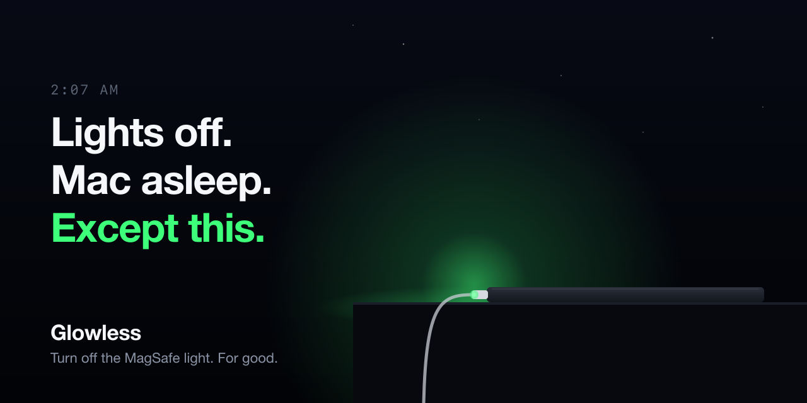
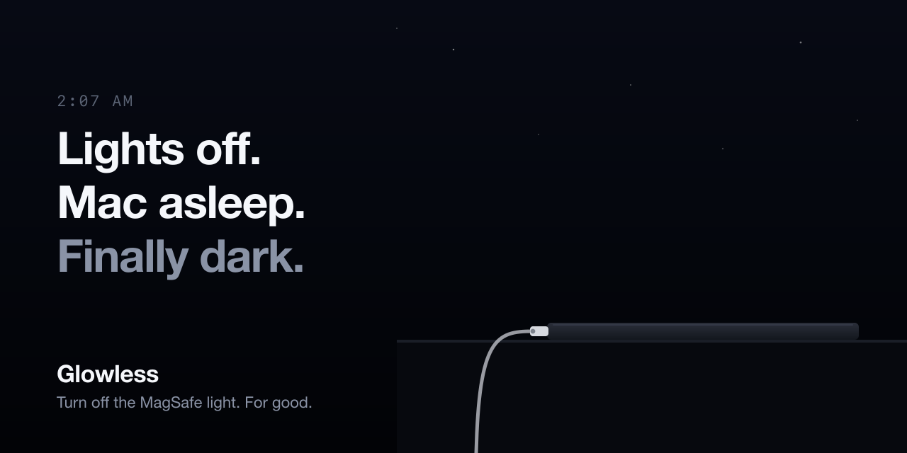
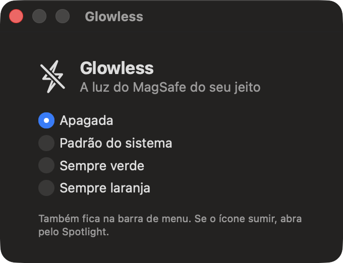

<p align="center">
  
</p>

<h1 align="center">Glowless</h1>

<p align="center">
  <b>Turn off the MagSafe light. For good.</b><br>
  A tiny menu bar app that kills the green/orange glow on your MacBook charger.
</p>

<p align="center">
  
  
  
  
</p>

---

You turn off the lights. The Mac goes to sleep. And there it is: a little green dot on the nightstand, lighting up the whole room like a tiny lighthouse.

macOS has no setting for it. Tape works, until you need to see the cable. **Glowless turns it off and keeps it off**, through replugs, charge changes and reboots.

<table>
  <tr>
    <td align="center"><b>Before</b></td>
    <td align="center"><b>After</b></td>
  </tr>
  <tr>
    <td></td>
    <td></td>
  </tr>
</table>

## Install

```sh
git clone https://github.com/gbretas/glowless
cd glowless
./install.sh
```

Needs an Apple Silicon MacBook with MagSafe, macOS 13+ and the Xcode Command Line Tools (`xcode-select --install`). It asks for your password once, to install the background service that talks to the hardware.

## Use



Click the ⚡ in the menu bar, or hit **⌘ + Space → Glowless** if your menu bar is crowded.

- **Apagada**: LED off
- **Padrão do sistema**: stock macOS behavior
- **Sempre verde**: always green
- **Sempre laranja**: always orange

Pick once. It starts with your Mac and stays that way.

<br clear="right">

## How it works

The MagSafe LED is driven by the SMC key `ACLC` (`0` system, `1` off, `3` green, `4` orange). macOS grabs it back every time the power state changes, so a single write doesn't stick.

| Part | What it does |
|------|--------------|
| `daemon/glowlessd.c` | Root launchd daemon. Reads `/Users/Shared/Glowless/mode` and rewrites `ACLC` every 2 seconds over IOKit. |
| `app/Glowless.swift` | Menu bar app + settings window. Writes the chosen mode to that file. |

No app needed if you prefer the terminal:

```sh
echo off > /Users/Shared/Glowless/mode
```

## Uninstall

```sh
./uninstall.sh
```

Gives the LED back to macOS and removes everything.

## Disclaimer

Glowless writes to the SMC, which Apple does not document. It only touches the LED key, but use it at your own risk.

## License

MIT. If it helped you sleep, a ⭐ helps others find it.
